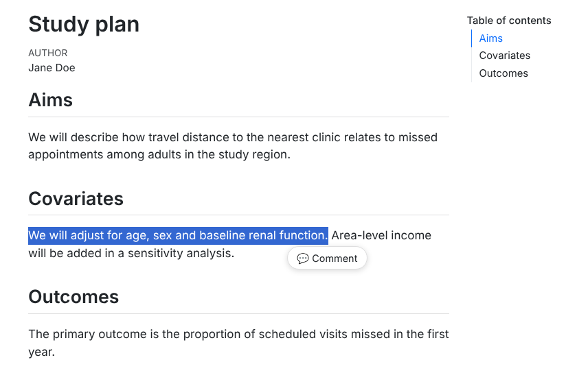
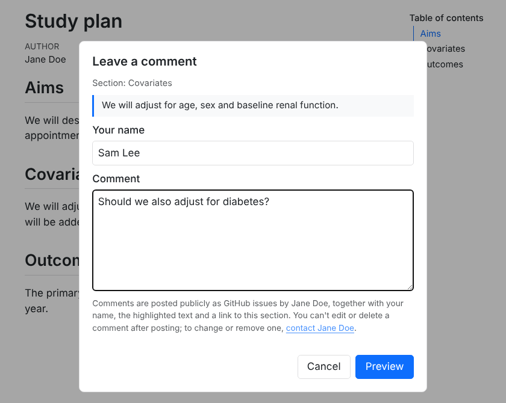
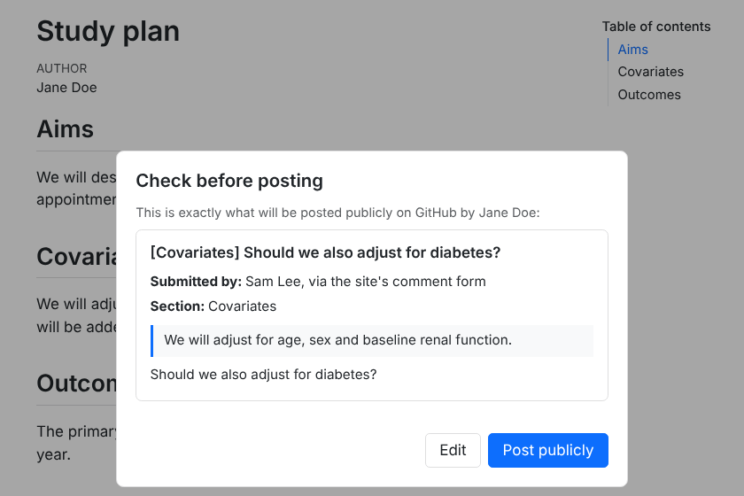
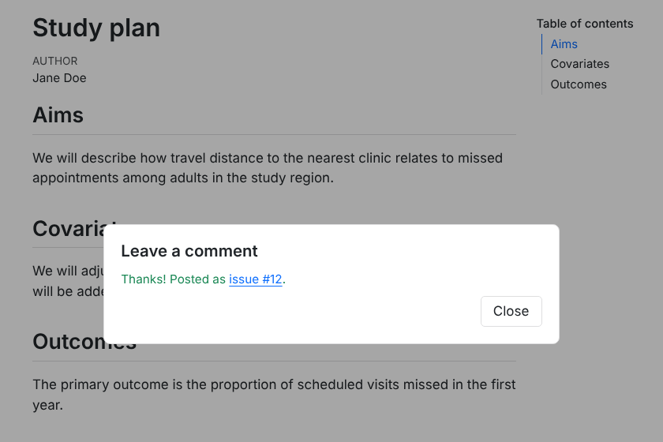
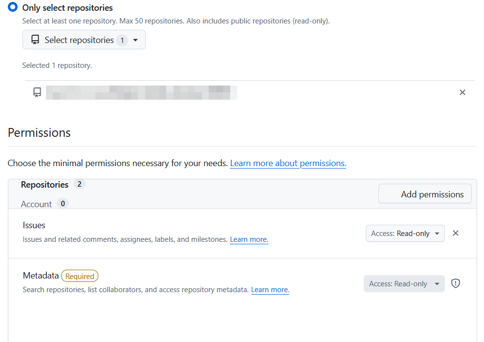
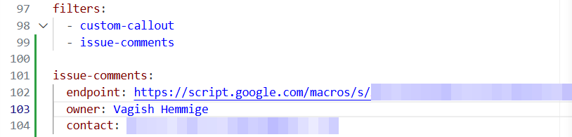
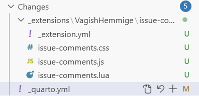

Setting up commenting takes about ten minutes, once. You need:

- a Quarto **website or HTML document** published somewhere public (GitHub Pages, Netlify, Quarto Pub, …); PDF and Word output are unaffected;
- a GitHub repository to receive the comments as issues. It doesn't have to be the site's own repository;
- a Google account, for the free Apps Script relay that holds your GitHub token.

::: {.callout-tip}
## Test on a repository you don't mind filling up
Every test comment becomes a real, public issue. A throwaway repository is the safest place to try it first.
:::

## What readers will see

A reader highlights a passage and clicks **💬 Comment**:

{fig-alt="A study plan page with one sentence highlighted and a Comment button just below it."}

They type their name and comment, and read who will post it and what becomes public:

{fig-alt="The comment dialog, showing the section, the quoted sentence, name and comment fields, and a notice that comments are posted publicly as GitHub issues."}

They check the issue exactly as it will be posted:

{fig-alt="The preview, showing the issue title with the section in brackets, who submitted it, the section, the quoted passage and the comment."}

And they get a link to the issue:

{fig-alt="A confirmation reading: Thanks! Posted as issue #12."}

The rest of this page sets that up.

## 1. Install the extension

In a terminal, in your Quarto project's folder (the one with `_quarto.yml`), run:

```bash
quarto add VagishHemmige/quarto-commenting-extension
```

Answer **Y** when it asks to confirm. It adds the extension under `_extensions/`. Commit that folder with your site.

## 2. Make a GitHub token

The token lets the relay create issues as you. It is set up to do that and nothing else.

1. Open GitHub's form for a new fine-grained token: <https://github.com/settings/personal-access-tokens/new>. To get there by clicking instead, use your **profile picture → Settings** (your account's settings, not a repository's **Settings** tab), then **Developer settings**, which is the last item at the bottom of the left sidebar, then **Personal access tokens → Fine-grained tokens → Generate new token**.
2. Give it a name, such as "issue-comments", and an expiry date. Commenting stops when the token expires, until you give the relay a new one.
3. Under **Repository access**, choose **Only select repositories** and pick the repository that will receive comments.
4. Under **Permissions**, add **Issues** and change its access to **Read and write**. GitHub adds it as **Read-only**, which won't work. Leave **Metadata** as Read-only; GitHub requires it.

   {fig-alt="GitHub's token form with Only select repositories chosen and one repository selected, and Issues and Metadata both showing Access: Read-only. The Issues one has to be changed to Read and write."}

5. Click **Generate token** and copy it straight away. GitHub shows it only once.

Why only one repository? The relay accepts comments from anyone on the internet, so what the token can do is the limit on any damage. Scoped like this, even a leaked token could only create and edit issues in that one repository. See [Security and privacy](security.qmd).

## 3. Create the relay in Google Apps Script

The relay is a small script in your own Google account. It holds the token, checks each comment and creates the issue.

1. Go to <https://script.google.com> and click **New project**. Rename it "issue-comments" by clicking "Untitled project" at the top.
2. Open [`Code.gs` as plain text](https://raw.githubusercontent.com/VagishHemmige/quarto-commenting-extension/main/apps-script/Code.gs), select all and copy. In the script editor, delete everything in `Code.gs`, paste, and click the save icon.
3. Click the **gear icon** (Project Settings) in the left sidebar. Under **Script Properties**, click **Add script property** and add:

   | Property | Value |
   |---|---|
   | `GITHUB_TOKEN` | the token from step 2 |
   | `GITHUB_REPO` | `owner/repo`, the repository that receives comments |
   | `SITE_PREFIX` | your site's published address, such as `https://owner.github.io/repo/`. Recommended: only pages whose address starts with this can post. |

   Then click **Save script properties**. The optional properties are on the [Options](options.qmd#relay-settings) page.
4. Click **Deploy → New deployment**. Click the gear next to "Select type" and choose **Web app**. Set **Execute as: Me** and **Who has access: Anyone**, and click **Deploy**.
5. Authorize when asked. Google says "Google hasn't verified this app", because the script is yours rather than a published app. Click **Advanced → Go to issue-comments (unsafe)**, then **Allow**.
6. Copy the **Web app URL**. It starts `https://script.google.com/macros/s/` and ends in `/exec`. To find it again later, use **Deploy → Manage deployments**. Don't use a URL ending in `/dev`.
7. Open the URL in a browser tab. It should show `{"ok":true,"message":"issue-comments relay is running."}`.

## 4. Turn it on in Quarto

Add this to `_quarto.yml` for the whole site, or to one page's front matter for just that page, using your `/exec` URL:

```yaml
filters:
  - issue-comments

issue-comments:
  endpoint: https://script.google.com/macros/s/XXXXXXXX/exec
  owner: Jane Doe
  contact: mailto:jane@example.com
```

- Put both at the top level of `_quarto.yml`, not under `website:` or `format:`.
- `owner` is the name readers are told will post the issue. `contact` is where they go to change or remove a comment: an email link, a contact page or your GitHub profile.
- If you already have a `filters:` list, add `- issue-comments` to it rather than starting a second one:

  {fig-alt="A _quarto.yml file in an editor: a filters list with custom-callout and issue-comments, followed by the issue-comments block with endpoint, owner and contact."}

Starting with one page is the cautious choice: once it's on in `_quarto.yml`, every page shows the Comment button.

## 5. Publish and test

Render and publish the site the way you usually do. Commit all of the extension's files with it, not just some:

{fig-alt="A source control panel listing the new files: _extension.yml, issue-comments.css, issue-comments.js and issue-comments.lua under _extensions, plus the changed _quarto.yml."}

Then open the **published** page, highlight a sentence, click **💬 Comment** and post. The issue should appear in your repository with the `reader-comment` label.

## If something doesn't work

The dialog says "Comments are not accepted from this page."
: The page's address doesn't start with `SITE_PREFIX`. This always happens in `quarto preview`, whose pages are on your own computer. Test on the published site, or leave `SITE_PREFIX` out while testing and add it afterwards. Otherwise check the prefix against the address bar, including capital letters and the trailing `/`.

The dialog says "Something went wrong."
: Most often the token: it lacks **Issues: Read and write**, it is for a different repository, or it has expired. The error itself is in Apps Script under **Executions**.

The dialog says "Commenting is not configured yet."
: `GITHUB_TOKEN` or `GITHUB_REPO` is missing from Script Properties.

There is no Comment button.
: Check that `issue-comments` is in `filters:`, that the `issue-comments:` block has an `endpoint`, and that the `_extensions/` folder is committed if your site is rendered on GitHub. Quarto prints a warning when it renders a page whose `issue-comments:` block has no `endpoint`.

Posting shows an error such as "Failed to fetch".
: The page couldn't reach the relay. Check that `endpoint` is the `/exec` URL and that the deployment's access is **Anyone**.

## Adding another site

Each relay sends to one repository and accepts comments from one site, because `GITHUB_REPO` and `SITE_PREFIX` each take one value. So a second site needs its own relay:

1. **Token.** Add the second repository to the token you already have: open it under Developer settings → Fine-grained tokens, choose **Edit**, add the repository, and save. A separate token also works, at the cost of a second expiry date to look after.
2. **Relay.** On the first relay's **Project details** page, use the copy icon and rename the copy. In its Script Properties, set `GITHUB_REPO` and `SITE_PREFIX` for the second site, and check that `GITHUB_TOKEN` is there. Then deploy it as in step 3 and copy its own `/exec` URL.
3. **Site.** Install the extension in the second site and give it the new `endpoint`.

If both sites should send comments to the same repository, you can skip step 1.
