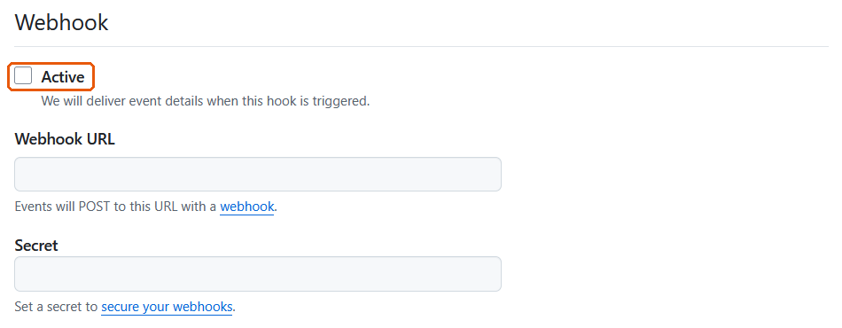
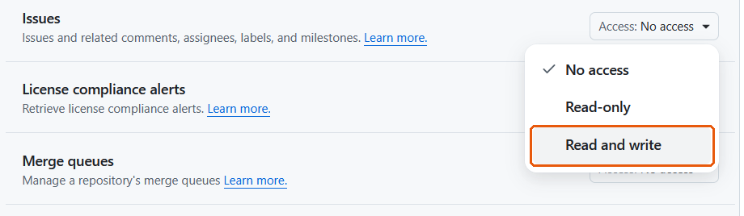

Setting up commenting takes about ten minutes, once. You need:

- a Quarto **website or HTML document** published somewhere public (GitHub Pages, Netlify, Quarto Pub, …); PDF and Word output are unaffected;
- a GitHub repository to receive the comments as issues. It doesn't have to be the site's own repository;
- a Google account, for the free Apps Script relay that holds your GitHub App's key.

Steps 2 and 3 are done once. After that, one relay serves every site you add, and [another site](#adding-another-site) takes a couple of minutes.

::: {.callout-tip}
## Test on a repository you don't mind filling up
Every test comment becomes a real, public issue. A throwaway repository is the safest place to try it first.
:::

## What readers will see

A reader highlights a passage and clicks **💬 Comment**:

{fig-alt="A study plan page with one sentence highlighted and a Comment button just below it."}

They type their name and comment, and read who will post it and what becomes public:

{fig-alt="The comment dialog, showing the section, the quoted sentence, name and comment fields, and a notice that comments are posted publicly as GitHub issues."}

They check the issue exactly as it will be posted:

{fig-alt="The preview, showing the issue title with the section in brackets, who submitted it, the section, the quoted passage and the comment."}

And they get a link to the issue:

{fig-alt="A confirmation reading: Thanks! Posted as issue #12."}

The rest of this page sets that up.

## 1. Install the extension

In a terminal, in your Quarto project's folder (the one with `_quarto.yml`), run:

```bash
quarto add VagishHemmige/quarto-commenting-extension
```

Answer **Y** when it asks to confirm. It adds the extension under `_extensions/`. Commit that folder with your site.

## 2. Create a GitHub App

A GitHub App is a GitHub account that belongs to the relay rather than to you. Issues it creates show as posted by a bot, such as **jdoe-comments[bot]**, so reader comments are easy to tell apart from your own, and GitHub notifies you of them as it would of anyone else's. The app is allowed to do one thing, work with issues, and only in the repositories you install it on.

1. Open GitHub's form for a new app: <https://github.com/settings/apps/new>. To get there by clicking instead, use your **profile picture → Settings** (your account's settings, not a repository's), then **Developer settings** at the bottom of the left sidebar, then **GitHub Apps → New GitHub App**.
2. **GitHub App name:** something like "jdoe-comments". The name has to be unused across all of GitHub, and it is what readers' issues will show as posted by.
3. **Homepage URL:** your site's address, or your GitHub profile. It is required but not used.
4. **Webhook:** untick **Active**. The relay only sends to GitHub; it never needs GitHub to call it.

   {fig-alt="The Webhook section of GitHub's new app form, with the Active checkbox unticked and outlined, and the Webhook URL and Secret boxes left empty."}

5. **Permissions → Repository permissions → Issues:** choose **Read and write**. Leave everything else at **No access**. GitHub adds **Metadata: Read-only** itself; if it doesn't, set Metadata to Read-only.

   {fig-alt="The Issues row under Repository permissions, with its Access menu open and Read and write outlined."}

6. **Where can this GitHub App be installed?** Choose **Only on this account**, then click **Create GitHub App**.
7. On the app's page that opens, note the **App ID** near the top. Scroll to **Private keys** and click **Generate a private key**. A `.pem` file downloads. You will paste its contents into the relay in step 3, and you can then delete the file.
8. Click **Install App** in the left sidebar, then **Install**. Choose **Only select repositories**, pick the repository that will receive comments, and click **Install**.

Why so narrow? The relay accepts comments from anyone on the internet, so what the app can do is the limit on any damage. Even if the private key leaked, it could only create and edit issues, as the bot, in the repositories the app is installed on. It could not touch your code or post as you. See [Security and privacy](security.qmd).

## 3. Create the relay in Google Apps Script

The relay is a small script in your own Google account. It holds the app's key, checks each comment, works out which repository it is for, and creates the issue.

1. Go to <https://script.google.com> and click **New project**. Rename it "issue-comments" by clicking "Untitled project" at the top.
2. Open [`Code.gs` as plain text](https://raw.githubusercontent.com/VagishHemmige/quarto-commenting-extension/main/apps-script/Code.gs), select all and copy. In the script editor, delete everything in `Code.gs`, paste, and click the save icon.
3. Click the **gear icon** (Project Settings) in the left sidebar. Under **Script Properties**, click **Add script property** and add:

   | Property | Value |
   |---|---|
   | `GITHUB_APP_ID` | the App ID from step 2 |
   | `GITHUB_APP_KEY` | the whole private key: open the `.pem` file in a text editor, copy everything including the `-----BEGIN` and `-----END` lines, and paste. It doesn't matter if the line breaks disappear. |
   | `GITHUB_OWNER` | your GitHub user name. A page at `https://<owner>.github.io/<repo>/` sends its comments to `<owner>/<repo>`. |
   | `PASSCODE` | optional: a passcode readers must enter. See [Options](options.qmd#passcode). |

   Then click **Save script properties**. If your site is not at `https://<owner>.github.io/<repo>/`, also add `REPO_MAP` (see [Options](options.qmd#relay-settings)). The other optional properties are there too.
4. Click **Deploy → New deployment**. Click the gear next to "Select type" and choose **Web app**. Set **Execute as: Me** and **Who has access: Anyone**, and click **Deploy**.
5. Authorize when asked. Google says "Google hasn't verified this app", because the script is yours rather than a published app. Click **Advanced → Go to issue-comments (unsafe)**, then **Allow**.
6. Copy the **Web app URL**. It starts `https://script.google.com/macros/s/` and ends in `/exec`. To find it again later, use **Deploy → Manage deployments**. Don't use a URL ending in `/dev`.
7. Open the URL in a browser tab. It should show `{"ok":true,"message":"issue-comments relay is running."}`.

## 4. Turn it on in Quarto

Add this to `_quarto.yml` for the whole site, or to one page's front matter for just that page, using your `/exec` URL:

```yaml
filters:
  - issue-comments

issue-comments:
  endpoint: https://script.google.com/macros/s/XXXXXXXX/exec
  owner: Jane Doe
  contact: mailto:jane@example.com
  passcode: true   # only if you set PASSCODE in step 3
```

- Put both at the top level of `_quarto.yml`, not under `website:` or `format:`.
- `owner` is the name readers are told the issue is posted on behalf of. `contact` is where they go to change or remove a comment: an email link, a contact page or your GitHub profile.
- Any wording readers see can be changed with a `text:` block; see [Options](options.qmd#wording).
- If you already have a `filters:` list, add `- issue-comments` to it rather than starting a second one:

  {fig-alt="A _quarto.yml file in an editor: a filters list with custom-callout and issue-comments, followed by the issue-comments block with endpoint, owner and contact."}

Starting with one page is the cautious choice: once it's on in `_quarto.yml`, every page shows the Comment button.

## 5. Publish and test

Render and publish the site the way you usually do. Commit all of the extension's files with it, not just some:

{fig-alt="A source control panel listing the new files: _extension.yml, issue-comments.css, issue-comments.js and issue-comments.lua under _extensions, plus the changed _quarto.yml."}

Then open the **published** page, highlight a sentence, click **💬 Comment** and post. The issue should appear in your repository with the `reader-comment` label, posted by your app's bot.

## If something doesn't work

The dialog says "Comments are not accepted from this page."
: The relay couldn't match the page to a repository the app is installed on. Check that the page's address is `https://<GITHUB_OWNER>.github.io/<repo>/…` (or is in `REPO_MAP`), and that the app is installed on that repository: **profile picture → Settings → Applications → Installed GitHub Apps → Configure**. This always happens in `quarto preview`, whose pages are on your own computer, unless you add the preview address to `REPO_MAP`; see [Options](options.qmd#relay-settings).

The dialog says "That passcode is not correct."
: The relay has `PASSCODE` set. If the page shows no passcode box, add `passcode: true` to the page's `issue-comments:` block.

The dialog says "Something went wrong."
: Most often the app: `GITHUB_APP_ID` is wrong, `GITHUB_APP_KEY` is incomplete, or the app lacks **Issues: Read and write**. The error itself is in Apps Script under **Executions**.

The dialog says "Commenting is not configured yet."
: `GITHUB_APP_ID` or `GITHUB_APP_KEY` is missing from Script Properties.

There is no Comment button.
: Check that `issue-comments` is in `filters:`, that the `issue-comments:` block has an `endpoint`, and that the `_extensions/` folder is committed if your site is rendered on GitHub. Quarto prints a warning when it renders a page whose `issue-comments:` block has no `endpoint`.

Posting shows an error such as "Failed to fetch".
: The page couldn't reach the relay. Check that `endpoint` is the `/exec` URL and that the deployment's access is **Anyone**.

## Adding another site

One relay serves every repository the app is installed on, so a new site needs no new script:

1. **App.** Add the new repository to the app: **profile picture → Settings → Applications → Installed GitHub Apps**, then **Configure** next to your app, add the repository under **Repository access**, and **Save**.
2. **Site.** Install the extension in the new site (step 1) and turn it on (step 4) with the **same** `endpoint`.

If the new site's address isn't `https://<GITHUB_OWNER>.github.io/<repo>/`, or its comments should go to a different repository than its own, add it to `REPO_MAP` too.

## Moving an older relay to the app

Relays set up before version 0.3.0 posted with a personal token and served one site each. To move one over without changing its `/exec` URL:

1. Create and install the app (step 2), on every repository your sites send comments to.
2. In the existing relay's Script Properties, add `GITHUB_APP_ID`, `GITHUB_APP_KEY` and `GITHUB_OWNER` (and `REPO_MAP` if needed). Keep the old ones for now.
3. Replace the script with the new `Code.gs`, save, and use **Deploy → Manage deployments → Edit → Version: New version → Deploy**. This keeps the URL.
4. Post a test comment from each site. Once they work, delete `GITHUB_TOKEN`, `GITHUB_REPO` and `SITE_PREFIX` from Script Properties, and revoke the old token on GitHub under **Developer settings → Personal access tokens**.
5. Sites that had their own relays can switch their `endpoint` to this one. Then delete the extra Apps Script projects.
